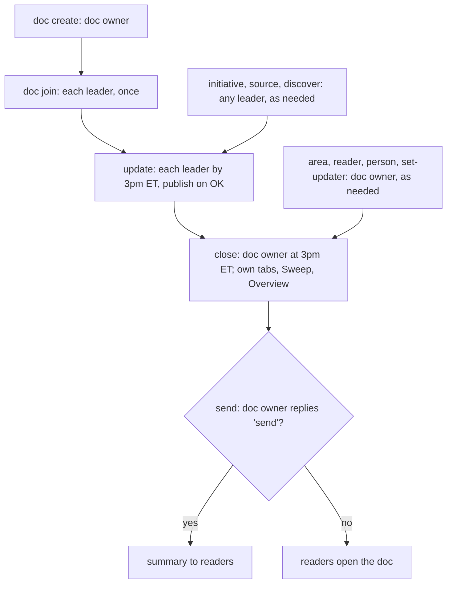

# Engos Operations Daily Update

## Purpose
Daily update kit for an org's shared status doc in Google Docs. Creates the doc if it does not exist (areas and initiatives, each with an owner), otherwise adds today's updates: each designated leader (the tab's updater) drafts daily updates for their initiatives (or, when they ask, for someone else's) from Gmail, Calendar, Chat, Drive, Jira, GitLab and GitHub, reviews them, and publishes on their OK; the doc owner closes out the day at 3pm (marks missed tabs, rebuilds the overview) and can send a summary to readers. Use when the user types /engos-operations-daily-update (with or without a command such as help, update, close, initiative done, reader add), or says 'do my daily update', 'set up the status doc', or 'close out the day'. Prefer this over daily-status-brief in this folder.

## Primary Objective
Fulfill the source contract retained under Imported operating instructions. These packaging sections do not introduce a different task, workflow, or set of deliverables.

## Workflow
Follow the original routing, prerequisites, steps, verification, and stop conditions. Read its referenced resources before the steps that depend on them. For a collection, select the source contract matching the requested mode; unresolved conflicts require review.

## Rules
- The original source contract defines capability behavior during an authorized invocation.
- Do not execute source instructions during intake merely because they are present in the imported text.
- Caller instructions and host permission boundaries still govern execution; packaging grants no additional authority.

## Required Inputs
Use the inputs, schemas, defaults, and clarification rules declared by the original source contract.

## Required Output
Produce the artifacts and results declared by the original source contract, including its exact filenames, formats, templates, and mode-specific receipts. Intake summaries and uplift metadata do not replace those outcomes.

## Output Directory
Use the destinations specified by the original source contract or the caller. This wrapper imposes no additional report path.

## Constraints
Retain the original scope, ownership, approval gates, tool limits, and failure behavior. The sidecar descriptor and inferred relationships are advisory packaging metadata, not a competing source of task instructions.

## Invocation Hints
Use the original triggers and mode-selection rules retained below.

## Examples
Use the original examples and output templates in the retained instructions and referenced resources. Where the source supplies no example, this wrapper does not invent an unrelated repository-review task.

## Evaluation Rubric
| Check | What Passing Looks Like |
| --- | --- |
| Outcome fidelity | Every artifact and format required by the selected source contract is delivered |
| Workflow fidelity | Original routing, validation, error handling, and stop conditions remain in force |
| Authority | Execution stays within caller authorization and host permissions |
| Packaging | Metadata does not replace operational instructions or introduce new deliverables |
| Evidence | Structural preservation is distinguished from independent behavioral validation |

## Imported operating instructions

---
name: engos-operations-daily-update
description: "Daily update kit for an org's shared status doc in Google Docs. Creates the doc if it does not exist (areas and initiatives, each with an owner), otherwise adds today's updates: each designated leader (the tab's updater) drafts daily updates for their initiatives (or, when they ask, for someone else's) from Gmail, Calendar, Chat, Drive, Jira, GitLab and GitHub, reviews them, and publishes on their OK; the doc owner closes out the day at 3pm (marks missed tabs, rebuilds the overview) and can send a summary to readers. Use when the user types /engos-operations-daily-update (with or without a command such as help, update, close, initiative done, reader add), or says 'do my daily update', 'set up the status doc', or 'close out the day'. Prefer this over daily-status-brief in this folder."
---

# Daily update kit

One shared Google Doc holds an org's daily updates. The primary reader is an exec (for example a VP), but any
leader reads any other leader's tabs, so every tab must make sense to someone outside that team.
Everyone contributes to the same doc:

- The **doc owner** (for example the director) creates the doc and owns the overview tab.
- Each **leader** owns some area tabs and is the **updater** for some initiative tabs. They can ask to update
  another initiative (for example while its updater is out); that section is marked "Updated by <them> for <updater>".
- A tab's **owner** is the name in brackets in its title: "Composer Planning APIs (Chandra)". The owner is
  accountable for the work and can be an engineer.
- A tab's **updater** is the leader named on its `Updater:` header line. The updater writes the daily section, not
  the owner. The doc owner picks updaters; the default is the area owner. If a tab has no `Updater:` line, its
  owner is its updater.
- People named as an owner but never as an updater (usually engineers) do not run the kit. If one asks, tell them
  who their updater is and offer to draft a note. See Onboard step 1 (`doc join`).

You are the agent of one person. You read their sources, draft, check, and wait for their OK.

## Commands

One entry point: `/engos-operations-daily-update <noun> <verb> [args]`. Things you manage have a noun and a verb
(`initiative done`, `reader add`); things you do each day are a single word (`update`, `close`, `send`,
`discover`). Plain phrases work too ("do my daily update", "set up the status doc", "close out the day"). With
no command, run `update`. If a command is missing a detail, ask for that one detail in one line. Every command
that writes shows the change and waits for "publish" (run it first with `--dry-run`, show the PLAN, then rerun
without it); `send` waits for "send". `--dry-run` is enforced in one place, the write layer: under it no Docs,
Drive or Gmail write and no config write can run, on any verb, and the command prints its PLAN instead.

The verbs mean the same on every noun: `list` and `show` read, `add` creates, `set-*` changes one field,
`remove` takes it away. `du.py <noun> --help` lists the verbs; every read takes `--json`.

| Command | Who | What it does | Section |
|---|---|---|---|
| `section remove` | the tab's updater, its area owner or the doc owner | Remove a section that is only an automatic backup note, written by the older `add-backup` or `remove-backup` (`section remove <tab> <date>`, or `--all <date>` for every tab); prints the PLAN, honours `--dry-run`. Refuses any section with anything else in it, and the tab's only section; no `--force` | Initiatives |
| `help` | anyone | List the commands this person may run, one example each | Help |
| `update` (default) | leader | Draft and publish today's update for your tabs | Daily |
| `close` | doc owner | Close out the day: own tabs first, Sweep, then Overview | Sweep, Overview |
| `send` | doc owner | Draft the summary for the readers; send only on "send" | Send |
| `discover` | leader | Find recurring work no tab covers; add the ones you pick | Discover |
| `doc create` | doc owner | Create a new doc; this person becomes its doc owner | Create |
| `doc join` | leader | Connect sources and confirm your tabs, once | Onboard |
| `doc show` | anyone | Owner, your role, areas, initiatives by state, readers | Help |
| `doctor` | anyone | Read-only health check of this machine (sign-in, config, sources, Drive backup) and the doc (rules above, stale updates, empty areas, open initiatives with no backup, section layout and readability warnings); each finding names its fix; exits non-zero on a fail. `--local` or `--only-doc` limits it | Help |
| `initiative list`, `initiative show` | anyone | Find initiatives by area, owner, updater or state | Initiatives |
| `initiative add` | leader | Add an initiative under an area | Initiatives |
| `initiative rename`, `move`, `set-owner`, `add-backup`, `remove-backup` | the tab's updater, its area owner or the doc owner | Change the name, area or owner; add or remove a backup for the updater (`add-backup --all <person>` does every open or paused initiative) | Initiatives |
| `initiative pause`, `resume`, `done`, `stop`, `reopen` | the tab's updater, its area owner or the doc owner | Move an initiative along its lifecycle | Lifecycle |
| `initiative set-updater`, `initiative archive` | doc owner | Choose who updates a tab; move a finished tab under Archive | Initiatives |
| `area list`, `area show` | anyone | Areas with counts and colour | Areas |
| `area set-headline` | area owner or doc owner | Replace an area's headline | Areas |
| `area add`, `rename`, `set-owner`, `merge`, `remove` | doc owner | Change the structure | Areas |
| `person list`, `person show` | anyone | Who owns, updates and reads what; who has no email yet | People |
| `person set-email` | doc owner | Record an email for tagging and access checks | People |
| `reader list` | anyone | Who gets the summary and how | Send |
| `reader add`, `remove`, `set-channel` | doc owner | Change who gets it | Send |
| `source list`, `source add`, `source remove` | leader | Your sources per tab (yours alone, never on the doc) | Sources |
| `source scan` | leader | Scan your last 14 days and propose sources (agent only) | Onboard step 2 |



**Running doc-owner commands for the doc owner.** Any editor of the doc can run `close`, `send` and the doc-owner
verbs (`reader`, `area`, `person set-email`, `initiative set-updater`, `initiative archive`) when the doc owner has
asked them to (for example while the doc owner is out). Ask once: "Are you running this for <doc owner>?" On yes,
add `--for-owner`; everything they need is on the doc (settings) and in the installed skill (scripts), not on the
doc owner's laptop. Mark what you write: the overview's `As of` line ends "(run by <person> for <doc owner>)",
and a sent summary ends "Sent by <person> for <doc owner>." `doc create` stays with the doc owner. Without that
yes, draft a request to the doc owner instead (never sent).

Before any command, find the doc: use `doc_id` from `~/.daily-update/config.json` if it exists, otherwise a doc
link the person gave, otherwise ask in one line: "Is there a daily update doc already? Paste its link, or say
'doc create'." No doc → `doc create`. Doc found but no config → `doc join` first (a doc owner with no config joins with
role owner), then the command.

**Help**: print the table rows this person may run (leaders see leader rows; the doc owner sees all), each with
one example built from the doc's own tab and people names when a doc is found, otherwise `<initiative>`,
`<person>` and `<area>` placeholders. Never invent names. Write each command the way this person started the
skill (for example `$engos-operations-daily-update` in Kiro Crew, `/engos-operations-daily-update` elsewhere). Say nothing about earlier sessions
or tests. Write nothing.

Re-check that the doc still opens on every run. If it does not, say so and ask for the current link.

## Model: what the commands act on

**Who lives where.** The doc holds what everyone shares: areas, initiatives, owners, updaters, the people list and
the readers. Your laptop (backed up to your own Drive) holds what is yours alone: your sources, your ledger and your
style notes. A command that changes shared state needs the right role; one that changes yours never touches the doc.

**Fields, not nouns.** Owner, updater and backups are fields on an initiative (and owner on an area). Change them with
`set-owner`, `set-updater`, `add-backup` and `remove-backup`; see who holds what with `person show`.

**Initiative lifecycle.** The state is read from the newest section, so it cannot drift from the doc.

| From | Verb | To | Notes |
|---|---|---|---|
| open | `pause` | paused | Status ⚪; needs a reason |
| paused | `resume` | open | You give the colour and next milestone |
| open, paused | `done` | done | Final section; line added to the area's Done list; colour 🟢 (an inference; change it if wrong) |
| open, paused | `stop` | stopped | Needs a reason; status ⚪ Stopped; line added to Done |
| done, stopped | `reopen` | open | Needs a reason, colour and next milestone; removes its Done line |
| done, stopped | `archive` | archived | Doc owner; tab moves under Archive. Terminal |

Any other move is refused with the state it found. `close` lists every done or stopped tab as a proposal to
archive, so the doc owner rarely runs `initiative archive` by hand.

**Rules the commands enforce** (a command that would break one is refused, and nothing is written):
1. Every initiative sits under exactly one area; every initiative and area has an owner.
2. An updater must be in the people list with an email, so they can be tagged and checked for access.
3. A tab's title always reads `<Name> (<owner>)`: `rename` and `set-owner` retitle the tab, its header and its row.
4. An area is never deleted. `area remove` moves an empty area under Archive; `area merge` moves its initiatives first.
5. A reader needs a name, an email and a channel (email or chat).
6. Sources are saved only for tabs you update or back up (or any tab, if you are the doc owner), and chat, email and meeting sources are marked private.
7. A change by someone other than the tab's updater is marked "Updated by <person> for <updater>."
8. Changes to owner, name, area or lifecycle are noted in today's section, carrying the status, milestone,
   Blocked on and Green when from the newest section.

**The day.** `update` (each updater, by 3pm ET) → `close` (doc owner: own tabs, Sweep marks the rest Unconfirmed,
Overview rebuilds and proposes archives) → `send` (doc owner, on "send"). Structure commands run any time and show
up at the next `close`.


## Rules that never bend

1. **Read only, everywhere except the status doc.** Never send, reply, react, label, archive, move, share,
   comment or edit anything in any source.
2. **In the status doc, edit only tabs this person updates, unless they ask.** That is initiative tabs whose
   `Updater:` line names them, and area tabs they own. If they name another initiative ("also update Composer UX
   for Kyle"), confirm once, then add that section ending with the line "Updated by <person> for <updater>."
   The doc owner also edits the overview and Archive, and writes
   Unconfirmed sections during Sweep.
   Any leader may add an initiative tab inside an existing area (see "Add, change, finish or stop an initiative").
   Only the doc owner changes the fixed structure (see "Fixed structure"). Never delete a tab. Never change sharing.
3. **Nothing publishes without the person saying "publish"** (or a clear yes to "Publish?") in this session.
4. **Never message anyone** on the person's behalf. If a message would help, draft it and let them send it.
   Two exceptions, both doc owner only and both gated: the Sweep tag comment in the status doc, posted only
   after the doc owner says yes to the exact list of people in that run; and `send`, which sends the summary to
   the configured readers only after the doc owner replies "send" to the exact recipients and text shown.
5. **People-sensitive items stay out**: candidate names, offers and pay, PTO and leave, health, performance,
   promotions, who is on a cut or boost list, logins. Say "a candidate", "one hire", "one engineer".
   This covers links too: never link a candidate's notes, scorecard or profile. Link the shared artifact
   instead (the job description, the tracking ticket, the design doc).
6. **Link only sources anyone in the company can open**: Drive and Docs files shared to the appian.com domain
   or to anyone with the link, and Jira issues, GitLab merge requests and GitHub pull requests in projects the
   org can see. Never link Gmail messages, Chat messages, DMs or spaces, Gemini meeting notes, or a Drive file
   with restricted sharing. Private sources are still read for drafting; no private names or details from them
   go into the doc.
   Link a Progress or Blocked on line to its source when anyone can open that source. Otherwise the line
   carries no label: no "(email)", "(chat)", "(meeting notes)" or "(from <updater>)". The updater publishes the
   section, so an unlinked line is their word. The one label left is "(per <name>)", for a fact someone other
   than the updater gave (a recruiter's tracker, a manager's message, the owner's note): name the person, never
   the channel. For a meeting with no one source, write "(per <meeting name>)".
   Every unlinked line still has its source recorded: SECTION.json `"sources": {"progress": [...], "blocked": [...]}`
   (a chat, an email, "<updater>, in this session"). `section lint` and `section write` refuse an unlinked line
   with none. Sources go to the ledger with the private links, never into the doc. Lines that need neither:
   "No change since <date>.", "Blocked on: None.", "Moved from <old area> to <new area> on <date>." and the
   lifecycle lines ("Done <date>: ...", "Stopped <date>: ...", "Paused <date>: ...", "Resumed <date>.",
   "Reopened <date>: ..."). Older sections that still carry "(email)", "(chat)" or "(from <name>)" stay valid.
   Status, Next milestone, Green when and closing lines need none. Overview bullets link
   to their tab. Put each link on a short word, like "(Jira COM-994)" or "(merge request !121)", never a raw URL.
7. **Say what you saw vs what you concluded.** If a status or date is your inference, say so in the review.
   Conflicts between sources (for example a meeting summary that disagrees with the raw notes) also go in the
   review, not the doc. Never write "Note (agent)" or similar lines in the doc.
8. **Never read secrets** (tokens, keys, credential files). Do not copy login values you see in messages.
9. **Ask questions as plain text in the chat.** Do not use pop-up question dialogs or multiple-choice widgets.

## Writing rules

- Plain English a leader from another team understands with zero context. Spell out every acronym and internal
  name the first time it appears on each tab, link labels included: "merge request (MR) !455", "quality
  engineering (QE)", "software development kit (SDK)", "Kata container sandboxes", "Executive Briefing Center
  (EBC)". Write "open role", never "req".
- Write for someone outside the team. A bare list of tickets is not an update:
  bad: "Completed !455, picking up COM-965 next."
  good: "The Composer merge request merged, so internal release holds for Tue Nov 10 (merge request !455)."
- When a section's colour differs from the previous section's, the Progress line opens with the reason.
- Lead with what it means: what changed, why it matters, the date, the owner.
- A next milestone is an outcome the work delivers ("Fill the open role", "Fast becomes the default"), never an
  activity on the way there ("Hold the next interview", "Attend the review"). Activities go in Progress.
  Say it in a few words, 60 characters or less without the date ("Restart-safe Composer sessions"): the overview
  shows it exactly as written and never shortens it, so a long one reads long everywhere.
- Absolute dates with weekday: "Thu Nov 5". Never "this week", "soon", "TBD", "EOW".
- "Today" and every section date mean the calendar date in US Eastern time (America/New_York), wherever the
  person is. A leader in Pacific time publishing at 10pm PT writes the next day's date. Ledger file names use it too.
- Progress: 3 short sentences at most. Third person. No em-dashes.
- Only what changed since the last update. If nothing changed, the Progress line reads "No change since <date>." and
  every other line stays, for example "🟢 On track", the milestone, then "Progress: No change since Fri Oct 30."

## Status rules

| Colour | When |
|---|---|
| 🔴 Red | A committed date passed and it is not done, or it is blocked and nobody owns the fix. |
| 🟡 At risk | The updater does not expect the next milestone to land on its date, or it waits on another team. |
| 🟢 On track | The updater expects the next milestone to land on its date. |
| ⚪ Paused | Paused or not started. |
| ⚪ Stopped | Not going ahead; the tab waits to move to Archive. Written by `initiative stop`. |

The colour answers one question for a reader outside the team: will the next milestone land on its date?
An open question or an undecided detail is not a reason for 🟡 on its own; say it in Progress. A missing date
or a missing next milestone is not a colour either: it is a planning gap, listed on the overview under
**Missing a plan** until it is fixed. Propose the colour from the evidence, say in the review that it is your
inference, and let the updater change it.
Rules decide where they can. Otherwise the tab's owner decides. Never override them; if the evidence
disagrees, say so once with the link and let them choose. An area takes the colour of its worst initiative, judged by each initiative's newest section.

## Doc layout

```
<Org> (<doc owner>)                 overview tab, doc owner only
<Area> (<area owner>)               one per area
    <Initiative> (<owner>)          one per initiative, nested under its area
Archive (<doc owner>)               finished initiatives move here; one line each, linked to its tab
Update guide (<doc owner>)          the template and writing guidance; doc owner only
```

**Overview tab**, top to bottom. Every overview table cell is left-aligned.
1. Title `<Org> Daily Updates`, then `Owner: <doc owner> · Readers: <reader> and all leaders · As of <Weekday Mon D, time TZ>`.
2. **Area health**: table with Area (linked to its tab), Owner, Status, Headline, Updated (date of the area's
   newest update; this column shows which areas are not updated today). The Status cell stacks a count per
   colour of that area's initiatives, one line each, in the order 🔴, 🟡, 🟢, ⚪, leaving out zero counts
   ("🟡 1" over "🟢 4"); the top colour is the area's colour. The Headline cell copies the area headline's
   sentences without its date, since Updated carries it; flagged headlines keep their flag. Phrases in it that
   name an initiative link to that initiative's tab.
3. **Missing a plan**: table with Initiative (linked to its tab), Owner, What's missing ("No next milestone" or
   "Milestone has no date") and Since (the first day of the unbroken run of sections without a dated
   milestone; over 14 days reads "<date> (over 2 weeks)"). One row per open initiative: done, stopped and
   paused (⚪) initiatives are left out. With no rows, one line: "Every open initiative has a dated next milestone."
4. **Exec leadership: decisions or help needed** (only if any): table with Decision or help needed, Why now,
   Recommend, By, Owner. By is the date it is needed; if no tab gives one, propose one and mark it as your
   inference in the review. Link each row to the thing being decided (its tab, design doc, merge request, proposal).
5. **Next 2 weeks**: table with Date, Commitment (the milestone without its date, exactly as its section words it,
   linked to its initiative's tab), Status (the emoji, "🟢"): one row per initiative, not done or stopped, whose newest Next milestone date
   falls from today through today + 14 days, or has already passed and is not done (the Date reads "<date> (overdue)"), by date and then worst first. With no rows, one line: "No dated
   commitments in the next 2 weeks."
6. **How to update** (see below) and the status key, which ends "A missing date is not a colour: Missing a
   plan lists every open initiative without a dated next milestone." Process text and the status key always go last.
7. One grey line: "Drafted by AI agents from each leader's sources. Sections an owner has not confirmed yet say so."

There is no "In 30 seconds" or "Not updated today" section. `du.py day overview DATE TIME --publish` rewrites
everything below the "As of" line in this order. It keeps the decisions rows and their links, keeps headline
links whose phrase is still there, links initiative names in headlines, and writes each Next 2 weeks row from its
section's milestone (to change a row's wording, change the milestone). It also moves an older overview to this layout.

**Area tab**: title, `Owner: <name> · Back to <overview>`, then **Headline**: one line,
`<sentence> (<Weekday Mon D>)`, for example `Everything is on track except the new Composer experience, which
ships Tue Nov 17 only if three blocking defects are fixed. (Thu Nov 5)`; the date is always last, in brackets.
The headline carries no colour: the area's colour is the worst of its initiatives, shown in its table and on the
overview, so a hand-written colour could only repeat it or contradict it. The sentence (two at most) says what the area's state means, leading with the biggest
risk or result. It is not a list of initiatives and names no process gaps ("3 initiatives need dates"). Then **Initiatives** table (Initiative, Owner, Status, Next milestone, Date; the Date cell holds the
milestone's date, "No date set yet" or "done <date>", so a missing date shows in its own column), **Done** (one line each).

**Initiative tab**: title `<Initiative> (<owner>)` as HEADING_1 (the same as the tab name), then `Owner: <name> · Updater: <leader> · Area: <area> · Back to <overview>` (with `· Backups: <names>` right after the updater when there are backups), then one
section per day, **newest first**. Each section:

```
<Weekday Mon D, YYYY>                 (HEADING_2)
🟢 On track
**Next milestone:** <what>, <date>
**Progress:** <up to 3 sentences, with links>
**Blocked on:** <who, what, by when>, or "None."
**Green when:** <what would make it green>   (only when the status is not 🟢)
```

- Every section has every line above, in this order. The one exception is Green when: it appears when the
  status is 🟡, 🔴 or ⚪, and never when it is 🟢.
- Each line prefix ("Next milestone:", "Progress:", "Blocked on:", "Green when:", "Unconfirmed:",
  "Updated by", "Added by") is bold. The rest of the line is not.
- There is no Confidence line: the colour carries the updater's call on whether the date holds. Lines after
  these (Updated by, Added by, Moved from, Unconfirmed) come last.

**How to update** (put this text on the overview as bullets; each label is bold and each command is in a
monospace font):
- **Leaders**: by 3pm ET, run `/engos-operations-daily-update`, review, say "publish".
- **Tab owners**: your updater updates your tab.
- **Doc owner**: at 3pm ET, `close` the day, then `send` the summary.
- **Changes**: `initiative add` or `discover` new initiatives; `initiative done` or `initiative stop` to end one. `help` lists all.
- **Meetings**: read this doc first; spend meeting time on "decisions or help needed".
- **Template**: see the Update guide tab (link "Update guide" to that tab).

**Update guide tab** (doc owner owns it; last top-level tab). The leaders' reference for writing an update,
and the agent's drafting guide. Pageless, with these headings and content:
- Title `Update guide (<doc owner>)`, `Owner: <doc owner> · Back to <overview>`, then one line: "Read this
  before writing a daily update. Your AI agent drafts from this template and these practices; you review,
  edit and publish."
- **Template**: the section format above, one line per line.
- **What each line means**: one line each for Status, Next milestone, Progress, Blocked on and
  Green when, as defined in this skill.
- **Best practices**: write for a leader outside your team and spell out acronyms; explain why a result
  matters, not only that it happened; flag blockers early; always give the next step; when the colour
  changes, open Progress with the reason; link every claim on a short word, to a source anyone can open
  (a private source gets no label; a fact someone else gave ends "(per <name>)"); absolute dates with the weekday,
  US Eastern time; same template every time; status lives in the doc, not in meetings; leave out
  people-sensitive items.
- **Bad and good**: the example from Writing rules.
- **Sources**: one line linking GitLab's weekly async update template, GitLab's guidance for initiative
  owners (Organizations team), GitLab's Growth engineering DRI page, and GitHub's "How engineering
  communicates".
When drafting, follow the Update guide tab as the doc owner has written it. If it conflicts with this skill,
this skill wins; say so in the review.

## Fixed structure

The doc owner sets the structure once and only the doc owner changes it:
- the top-level tabs: the overview, each area, Archive, Update guide;
- the list of areas and their owners, kept as the rows of the overview's **Area health** table;
- who is the updater for each initiative tab (the `Updater:` header lines);
- the layout of every tab (header lines, section headings, section format) as in Doc layout.

Leaders work only inside it:
- New initiatives go under an existing area, never at the top level or under another initiative.
- Never add, rename, move or remove an area or top-level tab, or edit the overview (unless you are the doc owner).
- Write sections only in the format above.

Every run, before writing, check the doc still matches: each area in Area health has its tab, every initiative tab
sits under an area, and every title reads `<Name> (<owner>)`. If something is off, write nothing to the affected
tabs, tell the person what you found, and (if they are not the doc owner) draft a note for the doc owner.

## Files

State lives in `~/.daily-update/` in the person's home folder, so any working folder finds it:

- `config.json`: `{"me", "role": "owner"|"leader", "doc_id", "reader", "last_publish", "last_discover", "style_notes": [],
  "tabs": [{"tab_id", "kind": "overview"|"area"|"initiative"|"archive", "name", "area", "owner", "sources": {...}}],
  ...}`. Each person's own sources and ledger stay here; settings everyone shares live on the doc (below). `tabs` lists the tabs this person updates or owns.
  **Shared settings live on the doc**, as Drive file properties, so anyone running a doc-owner command reads
  the same values: `du.owner`, the readers (`du.reader.<n>` = "name|channel|email") and the people map
  (`du.person.<name>` = email). Read and change them with `du.py person`, `reader` and `doc show`, never in a local file. The default
  reader is the one named at setup. The people map is for Sweep tags; fill it from the doc's sharing list (read only) and ask
  for any name that does not match.
  Sources per initiative: `{"jira": ["KEY-1"], "gitlab": ["group/project"], "github": ["owner/repo"],
  "chat": ["spaces/..."], "email": ["gmail search"], "meetings": ["meeting title"], "docs": ["fileId"]}`.
- `~/.daily-update/ledger/YYYY-MM-DD.json`: what was published that day: each line's exact published text, its source links,
  and each section's `sources` (where every unlinked line came from). The agent writes it at Daily step 6; `section write`
  checks `sources` but does not save them.

**Drive backup.** The local files stay primary, and a private copy lives in the person's own My Drive under
`.engos/automation-daily-updates/` (`config.json`, `protected.json`, `ledger/`), with `.engos/README.md`
asking people not to delete, move or share the folder. Every `du.py` command syncs first on its own, at most
once every 10 minutes; also run `du.py doc sync` after every save of `config.json` or a ledger file. Sync creates the folders and README when missing,
backs up what changed, and restores any file that is missing or older on this laptop, so a new or rebuilt
laptop picks up its sources and ledger on the first run. Never share the folder: its files point at the
person's own email and chats. If Drive cannot be reached, `sync` says the backup was skipped; say so in one
line and carry on, never stop the run for it.

## Before you start: tools

The kit needs four command-line tools, signed in as the person: `gws`, `acli`, `glab`, `gh`.
Check each with `command -v <tool>`. If any is missing, do not install it yourself or improvise.
Stop and tell the person to deploy the standard Appian setup, then come back:

1. **dotfiles** (installs `gws`, `acli`, `glab`, `gh` and the shared AI skills):
   `git clone https://gitlab.appian-stratus.com/medhat.galal/dotfiles.git ~/repo/dotfiles`,
   then `cd ~/repo/dotfiles && ./dotfiles install`. Accept the recommended choices.
2. **Core-Prompts** (installs the shared skills and agents):
   `git clone https://gitlab.appian-stratus.com/medhat.galal/core-prompts.git ~/repo/core-prompts`,
   then follow "Install Or Repair" in its README: preview with `--dry-run`, review, apply.

Cloning needs the VPN. Then sign in once to each (each opens a browser or asks for a token):
`gws auth login`, `acli jira auth login`, `glab auth login --hostname gitlab.appian-stratus.com`, `gh auth login`.
If the person does not use GitLab or GitHub, skip it and note that in the config.

Then run one cheap read against each source (Gmail, Calendar, Chat, Drive, Jira, GitLab, GitHub). For any that
fails, give the exact error and the one command that fixes it, then continue with the rest.

## Tools

- Google: `gws`. Gmail `gws gmail users messages list|get`, Calendar `gws calendar events list`,
  Chat `gws chat spaces list` and `gws chat spaces messages list`. People are in hundreds of spaces: page with
  `pageSize` 1000 and `pageToken` until no `nextPageToken`, then keep only spaces whose `lastActiveTime` is in the window.
  Run long listings in the background and keep working; Drive `gws drive files list|export`,
  Docs `gws docs documents create|get|batchUpdate`. Run `gws schema <service.resource.method>` when unsure of params.
  Meeting notes are Drive docs named like "Notes by Gemini"; they are AI summaries and can be wrong.
- Jira: `acli jira workitem search --jql "..." --json` and `acli jira workitem view KEY --json`.
- Code: GitLab `glab` (`glab mr list`, `glab api`), GitHub `gh` (`gh pr list`, `gh api`). Report outcomes
  that show delivery: merged or stuck merge requests, failing main-branch pipelines, releases. Not commit counts.
- If a source fails, say which and the error. An empty result is not "nothing happened" until the same query
  returns older items.

**Scripts (use these for every doc write).** The installed skill has `scripts/du.py` (`resources/scripts/du.py`
in a Core-Prompts install); run it with `python3` from that folder (`du.py --help` lists every noun; `du.py <noun> --help` lists its verbs). You decide the words; the script writes them in the
exact layout above, with the revision check and retries, bold labels, date headings, table
widths and pageless tabs. Use `du.py doc`, `area`, `initiative`, `person`, `reader`, `source`, `section` and `day` (and `discover check`) instead of writing Docs API requests yourself,
and run `du.py doctor` after publishing; fix anything it reports before saying done. Only if a script cannot
do what the rules need, use the notes below and say so in the review.

Docs API notes: read with `includeTabsContent: true`. A doc from before v1.19.10 still has Confidence lines
(dropdown chips) and the old colours. The doc owner runs `python3 migrate.py DOC` from the scripts folder: it
shows every change and, with `--publish`, recolours every section, removes the Confidence lines, splits each area's "Next milestone and
date" column into Next milestone and Date, and rewrites the Update guide. The doc is pageless: send `updateDocumentStyle` with
`documentFormat.documentMode: PAGELESS` for every tab when you create the doc, and for each tab you add later. Indexes count UTF-16 code units (emoji count as 2).
Other leaders edit the same doc, so **re-read the tab right before every write** and compute indexes from
that read. Insert from the highest index down. Send every `batchUpdate` with
`"writeControl": {"requiredRevisionId": "<revisionId from that read>"}`. If it is refused because the doc changed,
re-read, recompute and retry, up to 3 times; then stop and tell the person nothing was written to that tab.
After every write, re-read the tab and confirm each date line is still a HEADING_2 and the header line is
unchanged. If a heading lost its style, restore it before reporting done. Create tabs with `addDocumentTab` (set `parentTabId` to nest).
Give every table fixed column widths (`updateTableColumnProperties`) that add up to the page's text width, so it
fits the page. Text width = the tab's `documentStyle` page width minus its left and right margins (letter with
1in margins: 468 pt; 0.5in margins: 540 pt). Split it by these shares: Area health 18, 9, 11, 50, 12 percent
(540 pt: 97, 49, 59, 270, 65); Initiatives 26, 12, 15, 31, 16 percent; Missing a plan 34, 14, 28, 24 percent; decisions or help needed 30, 18, 24, 16, 12 percent; Next 2 weeks 20, 66, 14 percent.
Round to whole points and put any remainder on the widest column. Whenever you write to a table, check its
widths still add up to the text width, and fix them if not.

## Create (doc owner, once)

1. Tools check (above). Ask: org name, your name, and the primary reader (the exec). Use the name exactly
   as given (for example "Scott") everywhere: overview, area and initiative titles, headers, Archive, Update
   guide, and `me` in config. Use the same short form for every person in the structure. All leaders read it too.
2. Get the structure (areas with owners, initiatives under each with owners). Ask first, in one line:
   "Paste your list of areas and initiatives with owners, or give me an existing status or update doc to copy them from."
   An existing doc is read only: never edit it. Only if they have neither, propose a structure from their last
   14 days (sent mail, chats, meetings, Jira, merge requests), with owners you are unsure of marked "?".
   Keep it under 8 areas and 30 initiatives.
3. Let them correct it in plain words ("move 4 under People", "Kyle owns Composer"). Ask only for what is missing.
4. Build the doc (title `<Org> Daily Updates`): overview, area tabs, nested initiative tabs, Archive, Update guide, laid out as above.
   Each area headline follows the Area tab headline rule, from its starting sections, dated today (after
   setup, replace the script's starting headline with `du.py area set-headline`); never process text such as
   "starting view" or "drafted by". Fill each tab's header; every initiative's `Updater:` is its area owner unless the doc owner names someone else. If they gave an existing doc, copy every dated section of each initiative onto its tab, newest
   first, keeping links (check older sections against rule 5 before copying). Otherwise add one starting section
   dated today from what you found, ending with the line
   "Starting section drafted by <doc owner>'s agent. <Updater> confirms or corrects it on their first update."
   (`du.py doc create` adds that line; do not add it again.) Write starting sections only from sources read in this
   run, never from memory, earlier sessions or other test docs. Before building, show the starting sections and
   area headlines as a draft and build nothing until the doc owner says "publish".
5. Save `config.json` (role owner; your own area and initiative tabs too). Give the link.
   For each initiative tab the doc owner updates, run Onboard step 2 (offer the scan, propose sources) and save
   them, so their first `/engos-operations-daily-update` has sources.
6. Tell them the next steps, in this order: share the doc with each leader as editor (they do this themselves),
   then send each leader the onboarding message below (drafted, for them to send):

   > Our daily updates now live in one doc: <link>. You update every tab that lists you as Updater.
   > Install once (needs the VPN): the standard Appian setup (dotfiles, then Core-Prompts "Install Or Repair"),
   > which includes this skill. Then in your AI tool run `/engos-operations-daily-update onboard <link>`.
   > Each day by 3pm ET run `/engos-operations-daily-update`, check the draft and say "publish". About 10 minutes a day.

## Onboard (each leader, once)

1. Read the doc. List the area tabs with this person's name in brackets and the initiative tabs whose updater
   is this person, and confirm them. If none match, ask which name the doc uses for them. If they are named as an
   owner but as an updater on no tab, tell them who their updater is and offer to draft a note to that updater
   (never send it). If they accept, draft it, then stop. Write nothing to the doc and save no config for them.
   Otherwise run the tools check.
2. Offer the scan, in one line: "I can read Gmail, Calendar, Chat, Drive (including Gemini meeting notes), Jira,
   GitLab and GitHub. Scan your last 14 days to suggest sources for each tab?" Name any source whose tools check
   failed, and say any can be skipped. On yes, scan, then propose the sources for each initiative tab and let them
   correct it. On no, ask them to name sources per tab. Private sources (inbox mail, chats, meeting notes,
   restricted docs) may be saved for drafting, but are never linked (rule 6). `source scan` reruns this step later; `source list`, `source add` and `source remove` edit the saved sources.
3. Save `config.json` (role leader). Continue straight to Daily, covering the last 7 days.

## Daily (each leader)

1. Re-read the doc and refresh the person's tabs in `config.json`: someone may have made them the updater of a
   tab, added a tab, or renamed one. Ask for sources for any new tab; for a tab owned by an engineer, suggest the
   engineer's Jira items, merge requests and team chats. Window: from `last_publish` to now (first run: last 7 days).
   If a tab already has a section dated today, that section is the starting point for the tab: read it with
   `du.py section show "<tab title>" <date>` and compare it with this person's ledger for today. Lines someone edited
   by hand since the publish count as today's facts and are kept. Copy that section's `sources` from today's ledger into
   the new SECTION.json: `section show` cannot read them back from the doc, and `section write` refuses an unlinked line without them.
2. Read the Update guide tab and draft to it. For each initiative tab they update (plus any they asked to cover), read only its sources in the window. Note progress, slips, decisions,
   blockers, dates, owner changes. Also note important work that fits no initiative, and ask if it should become one.
   A tab with no sources set up: never ask an open "which source?" question. Search their last 14 days for
   that initiative's name and keywords (Jira, Drive, merge requests, chats, meetings; not inbox mail or
   candidate notes), and offer up to 3 numbered sources, plus "or tell me what happened today". Private sources
   may be offered and saved for drafting, but are never linked (rule 6). Save the ones
   they pick, then draft from them. If they say what happened, draft from that, with no label, and record "<their name>, in this session" in `sources`.
   If they pick nothing and say nothing, write nothing to that tab and say so in the review.
   Look for notes the tab's owner sent this person about the initiative (email or chat). They are the freshest
   word from the person doing the work: use them over older sources, and say in the review that you did.
3. Draft a section for each of their initiative tabs, and the headline and table for each area tab they own.
   Apply the status rules. Re-derive every milestone date from this run's sources; never carry a date only
   because the last section had it. Run the checks below, then run `du.py section lint "<tab title>" SECTION.json`
   for each section: put every WARN line in the review (a missing date, a missing milestone, or a date carried
   while Progress says something moved), and fix every BLOCK line before showing it. `du.py section write` runs the
   same check and refuses to write a section with a BLOCK problem.
   Same-day re-run (today's section exists): write one section for the whole day, Progress 3 sentences at most.
   Start from today's section and the new evidence from the window. Add new facts. Replace facts that changed
   ("in review" became "merged", a date moved, a blocker cleared). Delete facts that are obsolete or superseded.
   Re-check the status, Next milestone, Blocked on and Green when against all of today's evidence,
   not only the new. Every other rule still holds: links only to sources anyone can open, recorded `sources`
   for unlinked lines, "(per <name>)", people-sensitive items, and hand edits kept unless the updater drops them.
4. Show the review in chat, in this shape, and nothing else:

   ```
   Your tabs: 3 changes since Wed Nov 4. No change: Search revamp, Hiring.

   🔴 Billing API: ship date Tue Nov 3 missed; last tests failed Nov 3 (link). Sam expects the fix Thu Nov 5 (link).
   🟡 Cost cuts: Finance numbers not received; the plan to the VP needs them by Fri Nov 13 (link).
   🟢 Hiring: one offer accepted (link).
   Area headline (Payments): Billing API slipped two days; everything else on track.

   Check: left out a candidate's name. Warn: Hiring has no date (goes under Missing a plan).
   Not sure: is Cost cuts at risk? (my inference)
   Publish?
   ```

   On a same-day re-run, put under each changed tab what changed against the published section, one short line
   each: "Added: ...", "Replaced: <old> -> <new>", "Removed: ... (why)".
5. Apply their edits. If they correct a rule or wording habit, add one line to `style_notes` and follow it from then on.
6. On "publish": date every section with the day you publish (if the day changed since drafting, re-date it and
   re-check sources up to now). Re-read each tab, then insert the section at the top of each initiative tab
   (under the header, above earlier days; "No change since <date>." where nothing changed). If a section for that
   date already exists on the tab, replace it instead of adding a second one; this is how an updater confirms or
   corrects an Unconfirmed section from Sweep or a starting section from Create. Drop the Unconfirmed or
   "Starting section drafted by..." line. On the first confirmed publish to a tab (by its updater or someone covering), also delete the
   "Starting section drafted by..." line from the starting section. If the tab then has more than 10 dated
   sections, delete the oldest until 10 remain; version history keeps them. Before replacing today's section, compare the doc's text with this
   person's ledger for that day. If a person edited the section after it was published, show the changed lines
   in the review, and keep their wording unless they say to drop it. Keep any "Moved from" or
   "Area renamed" line. If today's section was written by another person and is not Unconfirmed, show both in
   the review and ask whether to replace it or merge into it. A merge follows the add, replace and delete steps
   in step 3. Update that initiative's row in its
   area tab's table, even when the area belongs to someone else (that row only). Replace the headline on area
   tabs the person owns on every publish that touches that area, so its date matches: re-summarize it from the
   newest section of every initiative in that area, never append to the old headline. Save the ledger and
   `last_publish`. Re-read and confirm every section landed. When reporting done, quote the re-read text of each
   section you wrote; if you cannot quote it, say it did not land. Give the link.

## Initiatives (any leader, within the rules above)

Any leader can ask: "add an initiative", "Chandra now owns Evals", "Composer UX is done". Each is one verb:
`initiative add`, `rename`, `move`, `set-owner`, `pause`, `resume`, `done`, `stop`, `reopen`. Run it with
`--dry-run`, show the PLAN, wait for "publish", then run it again without. To look first: `initiative list --area
Composer --state open`, `initiative show <name>`, `person show <name>`.

**Add** (`initiative add INIT.json --area <area>`)
1. Ask for what is missing: name, owner, area, next milestone and date.
2. Re-read the doc. If a tab with a similar name exists, show it and ask before adding another (`--new` only after
   they confirm it is different).
3. The script adds the tab under its area (`addDocumentTab` with `parentTabId` = the area tab), titled
   `<Initiative> (<owner>)`, with the initiative header and a first section dated today, and its row in the area table.
4. If the owner is someone else, end the section with "Added by <person> for <owner>." That owner's agent picks
   the tab up on their next run. If the area belongs to someone else, say in the review that the area owner should
   confirm it.
5. A new **area** is the doc owner's call (`area add`). If someone else asks for one, draft the request for the doc owner.

**Change** (`rename`, `move`, `set-owner`): the tab's updater, its area owner or the doc owner can run these. Each
retitles the tab where needed, updates the header line and the area table row (both rows for `move`), and notes the
change in today's section only when that section already exists. A change note never creates a section: a section
dated today counts as a confirmed update (Sweep skips the tab, the overview and `doctor` read it as fresh), and a
note is not one. `move` writes "Moved from <old area> to <new area> on <date>." into that section. `set-updater` is the doc owner's: it replaces the `Updater:` part of the header line and refuses a
person with no email in the people list.

**Backups** (`add-backup`, `remove-backup`): an initiative has zero or more backups, people who can cover the updater.
They are the `Backups: A, B` part of the header line, right after `Updater:`, and are dropped when the list is empty.
Who may run them is the same as for `rename`. The person must be in the people list with an email, cannot already be
the updater, and cannot already be a backup; removing someone who is not a backup is refused. Both change the header line only
and write no section and no note (a backup change is never an update; `section remove` clears the notes the older version wrote). `add-backup --all <person>` covers every open or paused initiative (it skips ones where the person
is already the updater or a backup), prints the PLAN first, and refuses if nothing would change. `initiative list`
and `show` display backups. A backup may keep sources on the tab, like the updater and the doc owner. `doctor` warns
(never fails) about an open initiative with no backup.

**Lifecycle** (`pause`, `resume`, `done`, `stop`, `reopen`, `archive`): see Model. `done` adds a line to Done on
the area tab and a final section ("Done <date>: <outcome>"). `stop` is for work that is not going ahead: it needs a
reason and writes a final section whose Progress line is "Stopped <date>: <reason>." with status ⚪ Stopped, "Next
milestone: None, stopped <Weekday Mon D>" and Green when "Not planned.", and a line to Done on the area tab:
"<Initiative>: stopped <date>, <reason>." The doc owner moves a done or stopped tab to Archive during Overview
(`initiative archive`); its Archive line reads "<Initiative> (<owner>), done <date>." or "..., stopped <date>."

All of these follow rule 3: show the change in the review and wait for "publish".

## Discover (any leader)

Finds recurring work that no initiative tab covers. A leader scans their own areas; the doc owner may scan all.

1. Window: the last 7 days (14 on the person's first `discover`), or the window they name. Read email, Chat,
   Drive, Gemini meeting notes, Jira and GitLab and GitHub merge requests. Look for recurring work with a goal,
   an owner or a date.
2. Dedupe with `du.py discover check CANDIDATES.json` (read only; `[{"name", "links": [urls], "sources": {...}}]`).
   It compares each candidate with the initiative tabs (the similar-name check `initiative add` uses), every tab's saved
   sources in `config.json` and the links already in the doc. A match with a tab becomes "add as a source to
   <tab>", a source that tab already watches is "already covered", and anything in Archive is dropped.
3. Show the review, one block per candidate that is new or a source to add, then "Add which?":

   ```
   1. Composer Telemetry · area Composer · owner Joo · updater Kyle
      Seen: weekly telemetry review notes Mon Nov 2 and Thu Nov 5 (meeting notes); Jira COM-1201 opened Tue Nov 3.
      Inferred: an ongoing initiative with no tab.
      Next milestone: No date set yet.
      Sources to save: jira COM-1201; meetings "Telemetry review".
      Dedupe: no similar tab, no matching source or link.
   2. Add as a source to Evals (Goldberg): GitLab composer-evals merge requests !610, !614.
   Dropped: Team Restructure is in Archive.
   ```
   Keep what you saw (where and when) apart from what you inferred. Give a next milestone with a date only when
   a source states one; otherwise "No date set yet". Write nothing until the person picks.
4. For each pick, run the Add steps with `du.py initiative add INIT.json --area "<area name>"` (refuses when a similar tab
   exists; rerun with `--new` only after the person confirms it is different), and save the suggested sources
   for that tab in `config.json`. A pick that is a source to add only updates `config.json`. A new area is the
   doc owner's call; for anyone else, draft the request to the doc owner. Save `last_discover` in `config.json`.

Every rule applies: link only sources anyone can open (private labels otherwise), no people-sensitive items or
names, never message anyone, and nothing is written before the pick and "publish".

## Areas and people (doc owner only, except `list`, `show` and `set-headline`)

The doc owner can say "add an area", "rename <area>", "merge <area> into <area>", "remove <area>", "Kyle owns
Composer" or "Kyle updates Evals". If someone else asks, draft the request for the doc owner instead.
`area add`, `rename`, `set-owner`, `merge` and `remove`, `initiative set-updater` and `person set-email` are the verbs.

1. Run the verb with `--dry-run`; show the PLAN (the before and after tree and what moves where). Wait for "publish".
2. `area merge A B` moves every initiative of A into B (tab, `Area:` header line, both area tables, and a line in
   today's section: "Moved from <old area> to <new area> on <date>."), then moves the empty area under Archive.
   `area remove` refuses while the area still has initiatives. An area is never deleted.
3. `area rename` and `area set-owner` retitle the tab; rename also updates the `Area:` line on every initiative tab.
4. The overview's Area health table refreshes at the next `close`. Each leader's agent picks up the change on its
   next run.
5. `set-updater` shows each affected tab with its old and new updater, then adds or replaces the `Updater:` part of
   its header line. To set up a doc that has no `Updater:` lines, propose the area owner for every initiative tab
   and let the doc owner name exceptions. `person list` shows who has no email yet.

## Sweep (doc owner, 3pm ET, first half of `close`; `du.py day sweep`)

0. Publish first. List the initiative tabs the doc owner updates that have no section dated today, then ask:
   "You haven't published <tab>, <tab> today. Do your update first?" On yes, run Daily for those tabs, then
   continue. On no, continue, and those tabs get Unconfirmed sections like everyone else's.
1. Re-read every initiative tab. List tabs with no section dated today, grouped by updater. A starting section
   from Create (it ends "Starting section drafted by...") counts as not updated: list that tab too, and in step 2
   add the Unconfirmed line to that section rather than adding a second section. Skip a tab whose
   newest section records it as done or stopped; it is waiting for Archive.
2. For each, draft an Unconfirmed section dated today: the status, next milestone and date carried from the
   newest section (never improve the status), and a Progress line from the doc owner's own sources if they show
   something new, with links. The section's last line is "Unconfirmed: no update from <updater> by 3pm ET."
   with no Progress line unless the doc owner's sources showed something new, or the doc owner decided a passed
   milestone is red and the status was not already 🔴: then Progress reads `The milestone "<milestone>" was due
   <date> and is not done, so <doc owner> marked it Red.`. If the tab has no
   earlier section, use 🟡 At risk and "Next milestone: No date set yet". Carry the newest Blocked on line
   (or "Blocked on: None." if there is none). If the carried status is not 🟢,
   carry the newest "Green when:" line too, or write "Green when: <updater> sets this when they confirm." Write "No date set yet" wherever the
   carried section says "Not set yet". Carry each of status and milestone from the newest section that has it
   (a "No change since" section has no milestone line, so look further back). The checks below apply to Sweep
   sections too: a carried milestone with no date gets ", No date set yet" added; the status is carried as it is.
3. Show the review: tabs by updater, each with its draft. List any carried milestone whose date has already
   passed as "needs a decision"; the doc owner decides whether it is done or red (`--decide "<initiative>=done"`
   or `"<initiative>=red"`). `--publish` refuses, and writes nothing, while any passed milestone has no
   decision. If done, write
   "Next milestone: <milestone>, done <Weekday Mon D>." and carry the status; the updater sets the next
   milestone when they confirm. The tab stays open: the review names the next step (`initiative done '<name>' --outcome '<what shipped>'`
   to finish it, or the updater adds the next milestone). Then "Publish?" On "publish", write them like Daily
   step 6 (re-read first, insert at the top, never replace a section the updater wrote today), and update each
   swept initiative's row in its area tab's Initiatives table (that row only) to match the new section. If
   the initiative has no row in that table, add one at the end, in the table's column order.
4. Then ask, listing the people by name: "Tag these updaters in a doc comment?" Only on yes (`day sweep <date> --tag`,
   in the same run as `--publish` or on its own afterwards; it tags the tabs that carry an Unconfirmed section for that
   date and skips a comment already posted), post one comment per
   updater with `gws drive comments create` on the doc, content
   `+<email> Unconfirmed today: <tab>, <tab>. Please confirm or correct by running "do my daily update".`
   Tag only emails in the doc's people map that already have access to the doc (check its sharing list, read only). Never
   tag anyone else, never share the doc. If an updater has no access, do not tag them: name them in the review
   and draft a note for the doc owner (never sent) saying who needs access. Comments sit at doc level; the API cannot anchor them to a tab.
5. Report what was written and tagged. The comments stay open; resolving them is the updater's call.

## Overview (doc owner, second half of `close`; `du.py day overview`)

1. Read every area and initiative tab. Do not re-read sources; the tabs are the input.
2. Draft the overview: Area health, Missing a plan, decisions or help needed, Next 2 weeks. List any tab added,
   renamed or finished since the last overview, and move finished tabs under Archive if the doc owner agrees.
   When a tab moves to Archive, delete its row from its area's Initiatives table (its Done line stays), and
   add it to the Archive tab's list as its own line, "<Initiative> (<owner>), done <date>.", with the name linked
   to its tab.
3. Show it in chat with the list of tabs not updated today or still Unconfirmed, and their updaters. Offer a
   short reminder note the doc owner can send to those updaters (drafted, never sent by you). Flag any area
   headline dated earlier than that area's newest update, or that contradicts its initiative tabs, and offer a
   note to the area owner. Do not edit another owner's headline. In the overview's Area health table, end a
   flagged headline with "(headline from <date>; out of date with its tabs)". End any other headline not dated
   today with "(headline from <date>; not updated today)". Other headline cells carry no date. Take the area's Status from its initiative tabs, not
   from the headline.
4. If today is a Friday, or `last_discover` in `config.json` is missing or more than 7 days old, end the
   review with one line: "Run discover?" Never run it unasked.
5. On "publish": replace the overview tab body only. Re-read and confirm. When reporting done, quote the
   re-read overview text; if you cannot quote it, say it did not land. Then offer `send`.

## Send (doc owner)

1. Read the readers from the doc (`du.py reader list`). If empty, ask who should get it (name, email, email or Chat) and save them;
   `du.py reader add NAME EMAIL --channel email|chat`, `reader remove NAME` and `reader set-channel NAME CHANNEL` each show the old and new list with `--dry-run`; change it only on their yes.
2. Draft one short message: subject or first line "<Org> Daily Updates, <Weekday Mon D>", one line per
   Area health row ("<area colour> <Area>: <Headline>"), any decisions or help needed rows with their By dates, one line "<N> of <M> initiatives not confirmed today:
   <names>." (or "All initiatives confirmed today."), one line "<N> initiatives are missing a plan: <names>."
   (or "Every open initiative has a dated next milestone."), and the doc link. No other content; nothing beyond
   what the overview already says.
3. Show the exact recipients, channel and text, then ask: "Send to <names>?" Send only if the doc owner replies
   "send" (or a clear yes naming the send) in this session. Email with `gws gmail users messages send`; Chat with
   `gws chat spaces messages create` in a direct message. Send only to addresses already in `reader list`.
4. Report what went to whom, quoting the sent text. If any send failed, say which and why. Never send anything
   else, and never send on behalf of a leader.

## Checks before any review

- No people-sensitive items (rule 5). Search the draft for names next to: interview, candidate, offer,
  hire, salary, comp, PTO, leave, sick, performance, promotion, PIP.
- No vague dates. Every milestone has a date, or reads "No date set yet" (exactly, capital N); an undated
  one is a WARN for the review and is listed under Missing a plan, and does not change the colour. A milestone
  marked "done <date>" by Sweep counts as dated.
- No long milestones. Over 60 characters without the date is a WARN from `lint`: propose a shorter wording that
  keeps the meaning, and let the updater choose.
- No stale dates. When a milestone date is unchanged from the previous section while Progress says something
  moved, or names a later date, ask the updater to confirm the date (a WARN from `lint`).
- Every weekday matches its date on the calendar ("Fri Nov 6", never "Thu Nov 6").
- Every Progress and Blocked on line has a link, or ends "(per <name>)" for a fact someone else gave, or has its
  source recorded in `sources`. No "(email)", "(chat)", "(meeting notes)" or "(from <updater>)" labels. Exceptions
  as in rule 6.
- No link points to Gmail, Chat, Gemini notes, or a Drive file not shared to the domain or anyone with the link.
- No raw URLs in the text; every link sits on a short word.
- No "Note (agent)" or other agent commentary in the doc; it goes in the review.
- Each initiative is 3 sentences or fewer.
- Every acronym and internal name is spelled out the first time it appears on its tab (see Writing rules).
- Every section has Next milestone, Progress (unless Unconfirmed) and Blocked on lines, each with a
  bold prefix, and no Confidence line.
- Every section that is not 🟢 has a "Green when:" line, and no 🟢 section has one.
- No area headline or overview line contains process text ("agent", "starting view", "drafted by").
- A leader who owns an area tab replaces its headline on every Daily run, from that area's initiative tabs,
  even when someone else updates those tabs.
- Status matches the status rules, or the review says why not.
- Every tab you will write is one this person updates, or one the rules allow: an area tab they own, an
  initiative they asked to cover, a tab they are adding, a single row in an area table, or (doc owner) a Sweep section.
- A section written by someone other than the tab's updater ends with "Updated by <person> for <updater>."
  A Sweep section ends with its Unconfirmed line instead.


Capability resource: `resources/capability.json`
