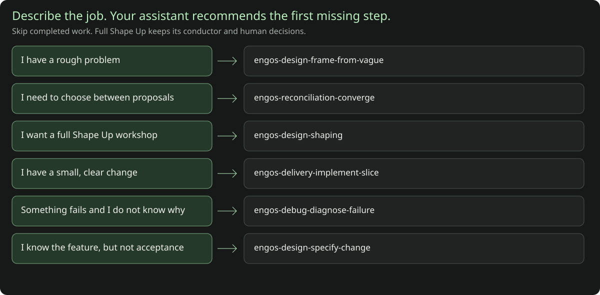

# Start with your intent

Describe the result you want and what you already have. The assistant should
recommend both a useful starting job and how far to take it, explain the reason,
and name the next artifact. The available `engos-orchestration-route-intent` skill
provides that intake across the current catalog, including nonengineering jobs.
You do not need to memorize skill names or decide
whether your request counts as "lightweight shaping" or "full Shape Up".

For example:

> Help me turn these rough notes into a clear problem statement. We have not
> agreed on a solution. Use the installed Core-Prompts skills that fit this job,
> preserve our project's rules, and explain your first step.

A suitable response starts with something like: “I’ll use
`engos-design-frame-from-vague` because the problem and outcome are still unclear.
You’ll get a solution-free frame, which fits your request to clarify the problem
before considering solutions. We can revisit the depth if you later need a
researched proposal for a team decision.” The assistant then carries
out the work already authorized by your request. Selecting a skill is not a new
permission ceremony.

[Open the portable visual guide](guide/index.html) to browse routes and mark
work you say is already accepted. Those selections are context for a recommendation,
not proof of acceptance or task completion. The guide does not interpret free-form
language or execute skills; the assistant applies the
[intent-routing policy](../.kiro/steering/skill-routing.md) to the actual context.
The [job map](SKILL-JOB-MAP.md) remains a source-side lookup aid. The routing
skill inspects the current inventory instead of treating these guide cards as a
fixed or complete list of available jobs.



## Let the assistant recommend how far to go

A request for help does not need a completed intake form. The assistant starts
with the conversation and supplied material, including decisions you have already
accepted. If your request is clear, it can choose the useful job and proceed:
"These requirements and this design are already accepted, so I’ll break the work
into verifiable tasks." A small demonstrated fix or an exact diff review should
not trigger a new interview.

When depth really is unclear, the assistant explains the practical options and
recommends one from your context. For a rough product idea, it might say:

> Your notes describe a problem, but do not yet identify the outcome to improve.
> I recommend clarifying that first. What result do you need next?
> A. A clear problem and desired outcome.
> B. Defined feature behavior and acceptance checks.
> C. Researched options and a reviewed proposal for a team decision.
> Other — describe the result you need, correct my premise, or say you are unsure.

Those are example outcomes, not a question every task must answer. With an actual
pair of proposals, the useful question may concern the decision criteria instead.
With an accepted feature spec, there may be no intake question at all. An available
question tool can present the choices; otherwise the assistant can ask inline and
adapt its next question to your answer. Every intake question has an Other/free-text
path, including the host's native Other field when supported. If the question tool
cannot offer free text, use inline choices. Known facts are not asked again, and
an unanswered recommendation is not a decision.

| Result needed next | Appropriate depth |
| --- | --- |
| Understand the problem and outcome before discussing solutions | A bounded, solution-free frame. "Lightweight" does not waive its evidence or acceptance rules. |
| Define a known feature's behavior, limits and acceptance | A specification in your existing format. |
| Choose among supplied alternatives | Compare the actual proposals and their trade-offs; missing inputs stay missing. |
| Work from a problem through research, shaping and a reviewed proposal | The shaping conductor, with the existing stage gates and human decisions. |
| Plan accepted scope, make a clear change, diagnose a failure or review an artifact | Start with that direct job; do not rebuild upstream stages without a reason. |

"Help us clarify the problem, investigate options and prepare a reviewed proposal
for our team to decide on" is enough to request the deeper shaping workflow.
You do not need to know its framework name. Conversely, "help me shape this idea"
may leave the desired deliverable unclear; a focused question can resolve it.
The assistant recommends the smallest depth that fulfills the actual request,
not the smallest output regardless of your goal and not an automatic full stack.

Choosing an outcome clarifies scope; it does not create unrelated permission to
run commands, edit code, delegate, launch a goal or publish. Already authorized
work can proceed without a new approval ceremony. Human appetite, acceptance and
betting decisions still belong to their actual owners.

The opted-in routing policy also preserves an Other/free-text path when a selected
Core skill asks you a question later in the work. You can correct the premise or
describe a result that its suggested choices missed.

## Find the first missing job

| What you mean | First useful job | What you receive |
| --- | --- | --- |
| “We have a problem, but cannot yet explain it clearly.” | `engos-design-frame-from-vague` | A solution-free frame: people, outcome, appetite and open questions. |
| “We know the feature, but not its exact behavior or acceptance.” | `engos-design-specify-change` | Requirements, acceptance checks and unchanged behavior. |
| “These two actual proposals disagree; help us choose.” | `engos-reconciliation-converge` | An attributed comparison and recommendation. Missing inputs are requested, not invented. |
| “Help us clarify the problem, research options and develop a reviewed proposal for a team decision.” | `engos-design-shaping` | Framing, research, shaping, review and delivery evidence under the existing stage gates; the human owner makes the betting decision. No framework name is required. |
| “Make this small, clear change.” | `engos-delivery-implement-slice` | A bounded patch, actual checks and remaining limits. |
| “This fails, and the cause is unclear.” | `engos-debug-diagnose-failure` | A supported cause or bounded unknown and a repair handoff. |
| “These requirements are accepted; break the work down.” | `engos-design-plan-implementation` | Verifiable tasks, dependencies, interfaces and holds. |
| “We need a material technical decision.” | `engos-design-architecture` | A justified design with alternatives, risks and recovery. |
| “Review this actual diff.” | `engos-quality-code-review` | Candidate-bound findings and review limits. |
| “Review this finished pitch.” | `engos-audit-pitch-review` | Pitch gaps and a betting-readiness recommendation, without invented workshop history. |

The distinction is the missing decision or artifact, not a keyword. “Plan” can
mean clarify a problem, specify acceptance, compare proposals or break accepted
work into tasks. Your context tells the assistant which job is useful. If a fact
would materially change that choice, it can ask a focused question while
continuing work that already has sufficient inputs and authority.

Existing accepted work lets you start later. A small repair with a supported
cause can enter implementation directly. Architecture is useful only when a
material technical decision remains; an absent architecture document alone does
not require a design pass. A real diff or finished pitch can be reviewed directly.
If the requested work is already satisfied, the useful result may be a verified
no-op rather than another stage.

## The same method covers every catalog job

For “audit this project,” the assistant uses the supplied purpose and sources.
If the goal remains unclear, it might recommend a structural code-health audit and
ask whether the result needed is A) maintainability risks, B) completeness against
a feature's scope, C) progress from project activity, or Other — describe the
decision you need to make. A supplied feature specification may settle that choice
without any question.

“Help with our incidents” may mean live coordination, retrospective operational
analysis or a technical diagnosis. “Prepare our update” may mean a report, an
attention queue or a presentation. The useful question concerns the requested
result and actual sources, not an engineering framework. Every question retains
Other/free text. Clear report and presentation requests go directly to their owners.

The routing skill inspects the current inventory and a resource table of conditional
**sequence**, **iterate**, **return**, **parallel** and **support** relationships.
Rows identify triggers, handed-off artifacts, stops, source bindings and evidence
class. A returned review issue is different from restarting an entire workflow;
parallel suggestions do not authorize workers or establish write safety.

New and updated skills remain eligible even without curated relationships. Stale
edges stay unknown rather than making an updated skill disappear. Read the selected
skill's current complete contract before relying on it. Bundled snapshots, paths
and descriptor hashes do not prove native discovery, installation or task success.

## Continue only when the next job is needed

A substantial feature often moves from **specification** to **architecture if
needed**, **useful task planning**, **one implementation slice**, and **review**.
Existing meaningful checks may make a separate test-design pass unnecessary.
Review feedback uses `engos-delivery-address-code-review` for selected actionable
comments. GitOps review assesses a requested merge/release gate; readiness does
not perform that external action. The [flow guide](SKILL-FLOWS.md) explains these
handoffs and their limits.

Full Shape Up work stays with the shaping conductor. Its existing G0/G1 framing,
G2 research, G3 review and G4 delivery contracts remain in force, together with
actual engineering agreement, team acceptance and human betting decisions.
A route card or checked box cannot replace those decisions or receipts. Draft-only
and frame-only requests retain their stopping points; changed uncertainty can
return work to an earlier stage. See the
[shaping workflow](engos-design-shaping.md) for the complete process.

Optional jobs stay optional:

- **Supercharge** strengthens an explicitly selected prompt, plan or proposal:
  `engos-meta-supercharge`.
- **Continuity** preserves a long investigation when you request a durable handoff:
  `engos-memory-context-continuity`.
- **Goal packets** compile reviewed intent when you explicitly want one:
  `engos-design-plan-to-goal`. Compiling does not launch the goal.
- **Batman** provides its controller-led delivery protocol when explicitly selected:
  `engos-orchestration-batman`. It is not the default route for a small fix.

Converge is directly useful when you supply competing inputs; it is not a compulsory
hop between ordinary stages. Audit, incident, documentation, presentation and other
jobs remain available through the [full job map](SKILL-JOB-MAP.md).

## A copyable request for any assistant

Replace the brackets and provide a trusted Core-Prompts root if the assistant
does not already have this guidance:

```text
Outcome: [what I want]
Context and existing accepted work: [inputs, decisions, design, plan or patch]
Authorized scope: [inspection, specific edits/checks, or other allowed actions]

Use the available Core-Prompts skills when they fit this request. Read
<CORE_ROOT>/.kiro/steering/skill-routing.md and resolve the routing data it
names for this source checkout or verified runtime. Human docs are optional
when the installed support root does not include them.
For materially vague intent or depth, use the available
engos-orchestration-route-intent skill and current resource inventory. Report
an unavailable package honestly and use only a bounded manual fallback.
Clear direct requests bypass redundant intake.
Recommend one first missing job and the needed depth from my intent, supplied
context and accepted work. Explain the result and why it fits before naming the
skill. Do not ask me to choose a framework. If an unanswered question would
materially change the route or depth, explain the relevant outcome options,
recommend one and ask a focused question using an available question tool or
inline choices. Every question must offer Other/free text. Reuse known answers;
do not run a standard interview or infer new permission from a recommendation.
Then proceed with the work already authorized above and give the next
conditional handoff. A recommendation is not additional permission.

Confirm the package this session can actually use. Read its complete SKILL.md
and only the resources needed for this job. Preserve my project, host and
home policies and existing review/approval gates. Do not invent missing inputs,
completed stages or new permission. Do not launch a chain of skills or a goal
just because the route mentions a next step.
```

This is a plain-language request, not a provider CLI flag. If you prefer a named
skill, keep using the documented host selector: Codex uses `$<skill-name>` and
Grok uses `/<skill-name>`. Other hosts use their current supported skill interface;
check session discovery rather than borrowing invocation syntax from another
provider. [Discovery and troubleshooting](GETTING-STARTED.md#verify-discovery-on-your-host).

## Opt in from a consumer project

The guide is portable, but its presence does not install a global router.
Core-Prompts' root `AGENTS.md` points at the policy for Core-Prompts work. Installing
skill packages or opening an HTML page does not prove that another project's
harness has loaded that pointer.

For a one-off session, paste the request above or explicitly provide the policy
and its routing data. Human docs and the visual guide can help when available;
they are not prerequisites for using an installed support root. For continuing use, a project owner can add a short pointer to the
project instruction file that their harness actually supports, such as `AGENTS.md`
where supported. Use a trusted, version-identified source checkout or verified
distribution as `<CORE_ROOT>`; keep it separate from the project being worked on.
A sample opt-in pointer is:

```text
This project opts into Core-Prompts intent routing when its skills fit the task.
Trusted Core-Prompts root: <CORE_ROOT>.
For Core skill selection, read <CORE_ROOT>/.kiro/steering/skill-routing.md
and use the source or runtime routing data it names. Human docs are optional;
do not require them in an installed support root. Apply this project's rules
and applicable host/home policies. This
pointer grants no additional actions and does not make every task a Core task.
```

The project owner chooses that integration; this change does not edit consumer,
home or provider configurations. Dotfiles remains the owner of home-global rules.
Ordinary use in a consumer project follows that project's workflow, not
Core-Prompts' source-maintenance UAC/worktree/PR/MR prerequisites.

Kiro's [official steering documentation](https://kiro.dev/docs/steering/) describes
workspace steering and always-included `AGENTS.md`; custom agents require explicit
steering resources. Therefore a custom agent's effective resource list must be
checked separately. This guide does not claim global autoloading or modify it.

## Where this guidance lives

- [Routing policy pointer](../.kiro/steering/skill-routing.md): when to invoke the
  available intake skill, clear-task bypass and authority boundaries.
- `engos-orchestration-route-intent`: the adaptive intake contract, read-only
  current-catalog inspector, intake-method resource and conditional relationship
  table. Resolve its actual package through the session's inventory; source
  presence alone does not prove availability or effective loading.
- [Compact route catalog](../.meta/intent-routing.json): shared descriptive data
  for common route cards and model lookup; not an executable classifier.
- [Existing source job map](../.meta/skill-job-map.json): skill identities and
  boundaries for source-side lookup. Runtime packages instead use
  the available skill inventory and relevant bundled
  [capability descriptors](../.meta/capabilities/).
- [Generated runtime route copy](../.kiro/steering/intent-routing.json): the same
  compact catalog beside the steering policy, available without human docs or the
  source-only job map. The selected skill's own contract remains authoritative.
- [Examples](EXAMPLES.md#start-without-a-skill-name): plain-language requests and
  the handoff to expect.

The [hosting guide](GUIDE-HOSTING.md) explains preview and publication choices;
no hosting activation follows from this document.

The visual guide is a presentation of this data. Static consistency checks can
verify names, links and generated content; they do not establish improved model
routing, native discovery or successful task execution.
